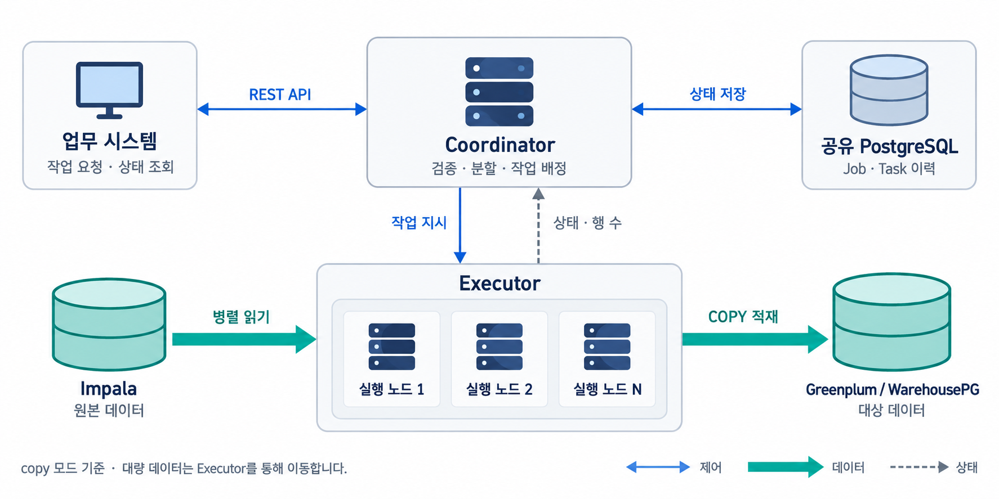
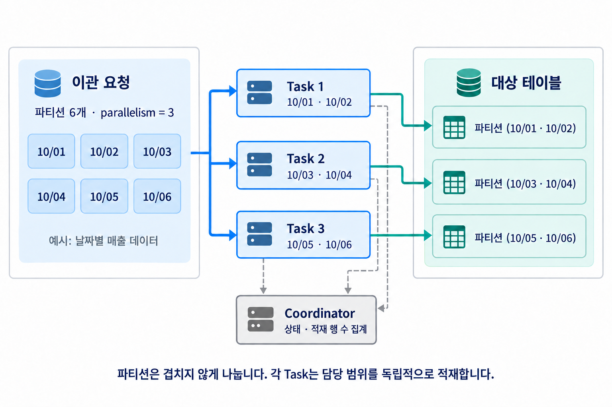
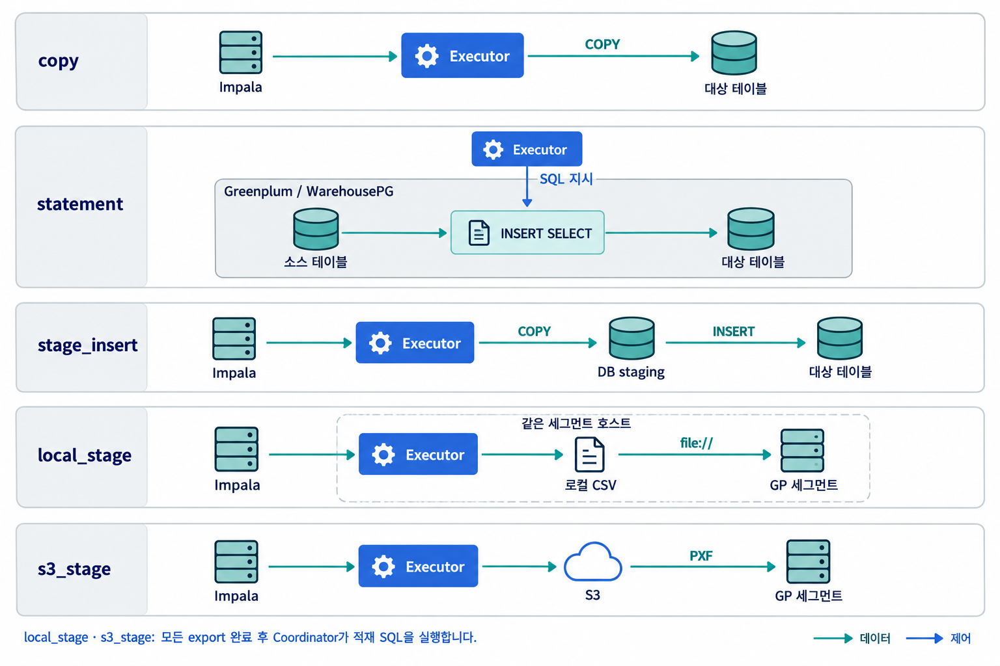
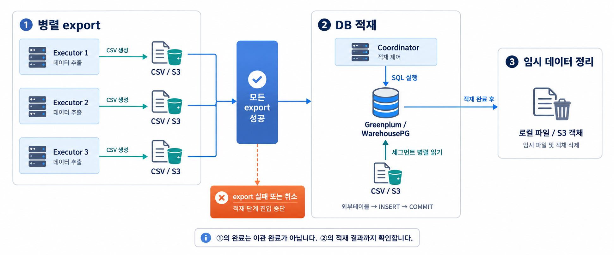
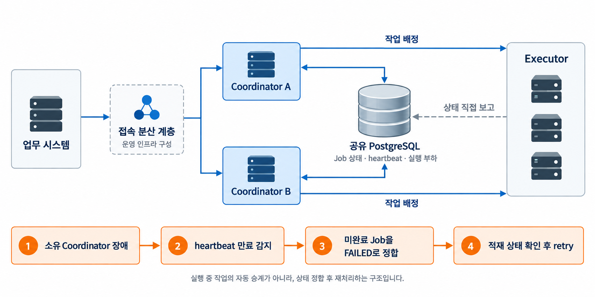
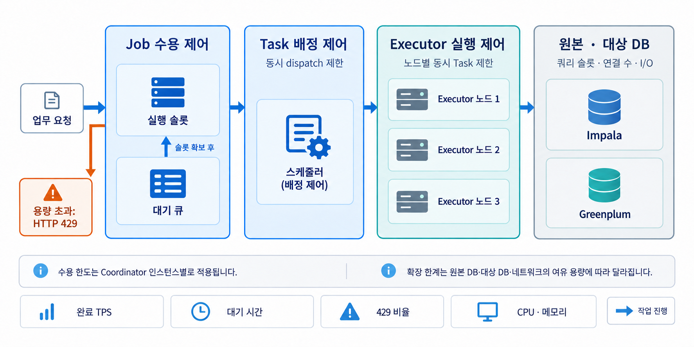

# Distributed Query Executor 기술 제안서

이 문서는 분산 쿼리 실행기를 처음 접하는 업무 담당자와 기술 검토자가 도입 목적, 처리 구조,
운영 조건을 이해할 수 있도록 작성한 기술 상세 제안서다. 기존 설계 문서와 구현을 바탕으로
현재 제공하는 기능을 설명하고, 도입 시 결정하거나 검증해야 할 사항은 별도로 명시한다.

제안하는 시스템은 **하나의 대량 데이터 이관 요청을 여러 작업으로 나누고, 여러 실행 노드가
동시에 처리하는 서비스**다. 기본 이관 대상은 Impala의 조회 결과를 Greenplum/WarehousePG에
적재하는 업무다. 사용자는 하나의 API에 요청하고, 시스템은 작업 분할·배정·상태 추적을 맡는다.

## 1. 제안 배경과 도입 목적

대량 데이터를 한 프로세스에서 순차적으로 옮기면 원본 조회, 네트워크 전송, 대상 적재 중
느린 구간이 전체 완료 시간을 좌우한다. 데이터가 늘어날수록 배치 시간 확보가 어려워지고,
일부 구간에 장애가 발생해도 어느 범위까지 처리했는지 확인하고 다시 실행하기가 복잡해진다.

본 시스템은 날짜와 같은 파티션 값을 기준으로 작업 범위를 나누어 이 문제에 대응한다.
여기서 파티션은 데이터를 구분하는 논리적인 범위를 뜻한다. 예를 들어 6일치 매출 데이터를
세 작업으로 나누면 각 작업은 서로 다른 2일치 데이터를 담당한다. 분할된 범위가 독립적으로
처리될 수 있을 때 여러 실행 노드를 활용해 전체 처리 시간을 줄일 수 있다.

| 검토 관점 | 제안 내용 | 기대 효과와 확인 조건 |
|---|---|---|
| 처리 시간 | 서로 겹치지 않는 파티션을 병렬 처리한다. | 원본·대상 DB와 네트워크에 여유가 있을 때 이관 시간을 단축할 수 있다. |
| 업무 연계 | 작업 제출과 상태 조회를 REST API로 제공한다. | 업무 시스템은 실행 노드의 주소와 대수를 직접 관리하지 않아도 된다. |
| 장애 대응 | Job과 Task 단위로 상태와 오류를 기록한다. | 실패 범위를 식별하고 적재 상태를 확인한 뒤 재처리할 수 있다. |
| 운영 안정성 | 실행 슬롯·대기 큐·노드별 동시 실행 수를 제한한다. | 요청 급증이 원본·대상 DB의 과도한 부하로 이어지는 것을 제어한다. |
| 확장성 | Executor 인스턴스를 추가한다. | DB·네트워크·디스크의 병목을 확인하면서 처리 용량을 단계적으로 확장한다. |

Executor를 두 배로 늘렸다고 처리 성능이 반드시 두 배가 되는 것은 아니다. 목표 처리량과
완료 시간은 실제 데이터 규모, 파티션 편차, 대상 DB의 수용 능력을 반영한 부하 시험으로 확정한다.

## 2. 전체 시스템 구성

*그림 1. 기본 copy 모드의 전체 구성. 파란 선은 제어 요청, 청록색 선은 데이터 이동,
회색 점선은 상태 전달을 나타낸다. 공유 PostgreSQL은 상태 외부화 구성에 해당한다.*

시스템은 작업을 관리하는 **Coordinator**와 데이터를 실제로 읽고 적재하는 **Executor**로
역할을 나눈다. 업무 시스템은 Coordinator에 요청하고, Coordinator는 검증한 작업을 Executor에
배정한다. 기본 `copy` 모드에서 대량 데이터는 Impala에서 Executor를 거쳐 대상 DB로 이동한다.
Coordinator에는 실행 상태와 적재 행 수 등의 제어 정보가 전달된다.

이 구조의 목적은 제어 서버에 데이터가 집중되는 것을 줄이고, 데이터 처리 자원을 Executor
단위로 확장하는 것이다. `local_stage`와 `s3_stage`에서는 Coordinator가 대상 DB에 적재 SQL을
실행하지만, 실제 파일 데이터는 DB 세그먼트가 직접 읽는다. 따라서 이 경우에도 대량 데이터가
Coordinator를 통과하지 않는다.

### 2.1 구성요소별 책임

| 구성요소 | 맡는 일 | 주요 입력과 출력 |
|---|---|---|
| 업무 시스템·스케줄러 | 이관 작업을 제출하고 완료 여부를 조회한다. | 요청 SQL 또는 템플릿·파라미터를 보내고 `job_id`와 상태를 받는다. |
| Coordinator | 요청 검증, 작업 분할, 수용량 제어, 실행 배정, 최종 상태 집계를 수행한다. | 요청을 Task로 변환하고 실행 상태·오류·행 수를 관리한다. |
| Executor | 맡은 범위의 데이터를 읽고 선택한 방식으로 적재 또는 export한다. | Task의 SQL과 적재 설정을 받아 처리 결과를 제공한다. |
| Impala | 이관할 원본 데이터를 조회한다. | 분할된 SELECT에 해당하는 행을 반환한다. |
| Greenplum/WarehousePG | 데이터 적재와 DB 내부 변환을 수행한다. | COPY 입력 또는 외부테이블 데이터를 받아 대상 테이블에 기록한다. |
| PostgreSQL | 공유 Job 상태와 실행 이력 등을 저장한다. | 여러 Coordinator와 Executor가 참조할 상태 정보를 유지한다. |
| 로컬 파일·S3 | 스테이징 모드의 중간 데이터를 보관한다. | CSV를 보관하고 DB의 병렬 읽기에 제공한다. 선택한 모드에서만 필요하다. |

단일 Coordinator 구성은 기본 메모리 저장소로 시작할 수 있다. 여러 Coordinator가 동일한
작업 상태를 조회·취소하는 운영 구성에서는 공유 PostgreSQL을 사용한다. 이 메타 저장소가
보관하는 것은 작업 정보이며, 이관 대상인 업무 데이터와 구분한다.

### 2.2 처음 읽는 독자를 위한 용어

**Job**은 사용자가 제출한 이관 요청 한 건이고, **Task**는 그 Job에서 나눈 실행 단위다.
Executor 한 대는 여러 Task를 처리할 수 있으므로 Task 수와 서버 대수가 항상 같지는 않다.
**세그먼트**는 Greenplum/WarehousePG 내부에서 데이터를 분산 저장하고 처리하는 구성요소다.
**스테이징**은 최종 테이블에 넣기 전에 파일이나 임시 테이블에 데이터를 준비하는 과정이다.

## 3. 요청 접수부터 완료까지의 처리

### 3.1 비동기 업무 연계

업무 시스템은 `POST /jobs`로 작업을 제출한다. Coordinator는 요청을 검증하고 작업을 분할한 뒤
수용 가능한 경우 `202 Accepted`와 `job_id`를 반환한다. **이 응답은 접수 완료를 뜻하며 데이터
적재 완료를 뜻하지 않는다.** 이후 클라이언트는 `GET /jobs/{id}`를 통해 종료 상태를 확인한다.

실행 슬롯이 부족하면 접수된 작업은 대기한다. 실행 슬롯과 대기 큐를 합친 수용량까지 차면
Coordinator는 `429 Too Many Requests`로 요청을 거절하고 재시도 간격을 안내한다. 클라이언트는
접수 거절과 실행 실패를 구분해 처리해야 한다.

템플릿을 사용하는 경우 클라이언트는 SQL 전문 대신 `template_id`와 파라미터를 전송할 수 있다.
Coordinator가 서버의 템플릿을 렌더링하고 검증·분할 과정을 수행한다. 이는 반복되는 이관 업무의
SQL과 입력 형식을 관리하는 데 유용하다. 요청별 SQL과 분할된 SQL은 작업 추적에 활용한다.

### 3.2 파티션 기반 분할과 병렬 실행

*그림 2. 파티션 분할 예시. 각 Task의 담당 데이터 범위는 겹치지 않으며,
Coordinator는 실제 결과 행 대신 실행 상태와 적재 행 수를 집계한다.*

예를 들어 `WHERE dt IN (...)`에 6개 날짜가 있고 `parallelism=3`이면, 연속 분할 방식은
앞의 2개 날짜를 Task 1에, 다음 2개를 Task 2에, 나머지를 Task 3에 배정한다. Executor들은
자기 범위만 조회하고 대상 테이블에 적재한다. 그림의 날짜는 이해를 위한 예시다.

분할 전략은 연속 구간을 묶는 `contiguous`와 값을 번갈아 배치하는 `round_robin`을 제공한다.
후자는 특정 구간에 데이터가 몰린 경우 분산에 도움이 될 수 있지만, 실제 행 수에 따른 균등
분할을 보장하지는 않는다. 업무별 파티션 크기와 Task 수행 시간을 함께 확인해야 한다.

분할 후에도 원래 SQL과 결과 의미가 같아야 한다. 특히 전체 범위에 대한 집계나 중복 제거를
분할별로 실행하면 전체를 한 번에 처리한 결과와 달라질 수 있다. 이 시스템에는 각 Task 결과를
모아 전역 집계 결과를 다시 만드는 일반적인 쿼리 병합 단계가 없다. 복잡한 SQL을 허용할 때는
분할 기준이 결과의 독립성을 유지하는지 검증한다.

### 3.3 완료 상태와 이력

| Job 종료 상태 | 의미 | 업무 시스템의 처리 |
|---|---|---|
| `DONE` | 해당 실행 경로의 작업이 성공적으로 끝났다. | 후속 배치를 실행하거나 결과를 검증한다. |
| `PARTIAL` | `best_effort` 정책에서 일부 Task만 성공했다. | 성공·실패 범위와 이미 적재된 데이터를 구분한다. |
| `FAILED` | 실패 정책 또는 적재 단계 오류 등으로 Job이 실패했다. | 오류 원인과 커밋된 범위를 확인한 뒤 재처리를 결정한다. |
| `CANCELLED` | 취소 요청에 따라 작업이 종료됐다. | 실행 중이던 작업과 대상 데이터 상태를 확인한다. |

기본 COPY 계열은 Task 단위로 트랜잭션을 처리하므로, Job이 실패했더라도 다른 Task가 이미
성공적으로 적재했을 수 있다. `fail_fast`도 앞서 커밋된 다른 Task의 데이터를 전체 취소하는
분산 트랜잭션은 아니다. 이 구분은 후속 업무의 실행 조건과 재처리 절차를 정할 때 필요하다.

## 4. 적재 방식의 기술 구성과 선택 기준

*그림 3. 실행 모드별 데이터 경로. local_stage와 s3_stage의 마지막 세그먼트는 대상 DB의
병렬 적재 경로를 뜻한다. statement는 대상 DB 안에서 SQL을 실행한다.*

| 실행 모드 | 처리 방법 | 선택하는 상황 | 도입 전 확인할 조건 |
|---|---|---|---|
| `copy` | Executor가 Impala 결과를 읽어 대상에 `COPY FROM STDIN`으로 넣는다. | 기본적인 이기종 데이터 이관을 시작할 때 적합하다. | SELECT 컬럼과 대상 컬럼의 호환성, DB 연결 수와 COPY 처리량을 확인한다. |
| `statement` | Executor가 대상 DB에 SQL을 전달해 실행한다. | 대상 DB 안에서 `INSERT SELECT` 등의 작업이 가능한 경우 사용한다. | SQL이 대상 DB에서 실행 가능한지 확인한다. Impala 결과를 자동으로 전달하는 방식은 아니다. |
| `stage_insert` | Impala 결과를 DB staging에 COPY한 뒤 INSERT로 변환·적재한다. | 읽기와 대상 DB의 변환 SQL을 분리해야 할 때 사용한다. | staging의 생성·격리·정리와 INSERT 컬럼 매핑을 확인한다. |
| `local_stage` | Executor가 세그먼트 호스트에 CSV를 쓰고, DB가 `file://`로 읽는다. | 세그먼트 호스트에 Executor를 배치할 수 있고 로컬 병렬 적재가 필요한 경우 사용한다. | 호스트별 파일 수 한도, 경로·권한·디스크 여유와 실제 세그먼트 호스트 매핑을 확인한다. |
| `s3_stage` | Executor가 CSV를 S3에 올리고, DB 세그먼트가 PXF를 통해 읽는다. | Executor와 세그먼트의 같은 호스트 배치가 어렵고 S3를 사용할 수 있을 때 사용한다. | S3 접근 권한, PXF 설정, 네트워크 대역폭과 임시 저장 공간을 확인한다. |

일반적인 도입 순서는 기본 `copy`로 기능과 처리량을 검증하고, 실제 측정에서 적재 구간의
병목이 확인되면 배치 환경에 맞는 스테이징 모드를 검토하는 것이다. 스테이징은 병렬 읽기를
활용할 수 있지만 파일 생성·업로드·정리 비용과 추가 운영 요소가 생긴다.

커스텀 소스 연계는 현재 `local_stage`와 `s3_stage`의 export 경로에 적용된다. Trino나 사내 API를
연계할 때는 전량 조회용 `query.func.fetch_module`을 구현한다. 행 수를 제한하는 미리보기용
`query.func.module`과 계약이 다르므로 두 함수를 혼용하지 않는다. 커스텀 조회가 결과를 한 번에
반환하면 Task의 전체 결과가 메모리에 올라갈 수 있어 청크 반환 또는 파티션 크기 조정이 필요하다.

## 5. 대량 데이터 스테이징의 단계별 처리

*그림 4. local_stage와 s3_stage의 처리 경계. 모든 export의 성공을 확인하는 지점을
barrier라고 하며, 그 이후에 대상 DB 적재를 수행한다.*

첫 단계에서 Executor들은 각자의 데이터를 CSV로 추출한다. `local_stage`는 세그먼트 호스트의
로컬 경로에 파일을 준비하고, `s3_stage`는 로컬 CSV 생성 후 Job별 S3 경로에 업로드한다.
S3 업로드가 완료되면 해당 로컬 임시 파일을 삭제한다. 따라서 S3 방식도 export 중에는 로컬
디스크 공간이 필요하다.

다음으로 Coordinator는 모든 export의 성공을 확인한다. 실패 또는 취소가 있는 상태에서
정상적인 적재 단계로 진행하지 않는다. **export Task의 완료와 최종 테이블의 적재 완료는
서로 다른 사건**이며, 클라이언트는 최종 Job 상태까지 확인해야 한다.

적재 단계에서 Coordinator는 Greenplum/WarehousePG에 외부테이블과 INSERT SQL을 실행한다.
`local_stage`는 외부테이블에서 staging을 거쳐 대상에 넣고, `s3_stage`는 Job의 S3 경로를
가리키는 외부테이블을 읽어 대상에 넣는다. 실제 파일 읽기는 세그먼트에서 병렬로 수행된다.
이 단계의 DB 변경은 하나의 트랜잭션으로 처리한다.

정상 처리 후에는 설정에 따라 로컬 파일 또는 S3 객체를 정리한다. 적재 성공 여부와 정리 성공
여부는 운영상 구분해 확인한다. 정리 실패가 발생했다고 이미 커밋된 데이터를 곧바로 다시
적재하면 안 된다. 원인 분석 목적으로 파일 보존을 선택한 경우에는 보존 기간과 용량 관리
절차를 함께 정한다.

## 6. 데이터 정합성과 재처리 설계

### 6.1 중복 요청과 중복 데이터의 구분

요청 멱등성은 동일 요청의 반복 제출을 제어한다. 같은 `Idempotency-Key`로 같은 요청 본문을
보내면 기존 Job을 반환하고, 같은 키에 다른 본문을 보내면 충돌로 처리한다. 이는 신규 Job을
중복 생성하는 문제를 다루며, 데이터 자체의 중복 적재 방지와는 다른 기능이다. 키의 효력은
저장소에 기존 Job과 키가 유지되는 범위에 따른다. PostgreSQL 저장소와 달리 WarehousePG
메타 저장소는 분산키 제약으로 키 선점이 best-effort임을 고려한다.

데이터 멱등성은 같은 범위를 다시 실행해도 중복되지 않도록 적재 방식을 정하는 것이다.
지원 경로에서 `overwrite_partitions`는 담당 파티션을 삭제하고 같은 트랜잭션에서 다시
적재한다. `append`는 기존 데이터에 추가하므로 재실행 자체가 중복 방지를 보장하지 않는다.
S3 경로는 명시한 `pre_delete`가 선삭제 여부를 재정의하므로 함께 확인한다.

이 조건을 적용하려면 삭제 기준 컬럼과 값이 실제 재적재 범위와 일치해야 하며, 서로 다른
Job이 같은 대상 파티션을 동시에 갱신하지 않도록 업무 실행을 조정해야 한다. 날짜 fan-out을
사용하는 `stage_insert` 경로는 append로 동작하므로 별도의 대상 정리·격리 전략을 정한다.

### 6.2 장애별 처리 원칙

| 장애 상황 | 현재 처리 구조 | 재처리 시 확인할 사항 |
|---|---|---|
| Task 전달 시 연결 실패 | 같은 Executor에 재시도하며, 미접수가 확실한 접속 실패·429·503만 다른 후보로 넘긴다. | 응답 유실로 접수 여부가 불확실하면 후보를 바꾸지 않고 기존 실행을 확인한다. |
| 실행 중 Executor 연결 유실 | 폴링 재시도를 소진하면 실패 처리하며 자동 재배정하지 않는다. | `overwrite_partitions`도 기존 실행과 겹치면 안전하지 않으므로 실행·커밋 여부를 확인한다. |
| Executor가 보고한 SQL·적재 오류 | Task를 실패 처리하고 Job의 실패 정책을 적용한다. | 연결 재시도로 해결할 수 있는 오류와 구분해 SQL·스키마·데이터를 수정한다. |
| 일부 Task 실패 | `fail_fast` 또는 `best_effort` 정책을 적용한다. | 성공 Task의 커밋 결과를 보존한 채 재처리 범위를 결정한다. |
| Coordinator 장애 | 저장소와 HA 설정에 따라 중단되거나 소유자가 사라진 Job의 상태를 정합한다. | 자동 실행 승계로 간주하지 않고, 남은 실행과 적재 결과를 확인한다. |
| 사용자 취소 | 실행 노드에 협조적 취소를 전달한다. | 취소 요청 응답만으로 모든 DB 작업이 즉시 종료됐다고 판단하지 않는다. |

종료된 Job의 실패·취소 Task는 `POST /jobs/{id}/retry`를 이용해 새 Job으로 재실행할 수 있다.
다만 export 이후 Job 단위 적재에서 실패하는 스테이징 경로는 오류 발생 단계와 중간 파일의
존재 여부까지 확인해야 한다. retry라는 API 이름만으로 모든 적재 방식의 복구가 자동으로
해결된다고 가정하지 않는다.

## 7. 고가용성과 운영 배치

*그림 5. 다중 Coordinator의 제어 구성과 장애 복구 절차. 접속 분산 계층은 운영 환경에서
마련할 배치 요소이며, 애플리케이션 자체에 내장된 장비를 뜻하지 않는다.*

고가용성 구성에서는 여러 Coordinator가 공유 PostgreSQL의 Job 상태를 참조한다. 업무
시스템은 어느 Coordinator를 통해서도 작업을 조회하거나 취소할 수 있다. Executor는 자신의
상태와 부하를 공유 저장소에 직접 보고하고, Coordinator는 이를 작업 배정에 활용한다.

주요 설정은 `store.backend=postgres`, 공통 `history.db_dsn`, `executor.self_report=true`다.
부하 기반 배정은 `coordinator.executor_select=p2c`로 구성할 수 있다. P2C는 살아 있는 후보
두 개를 임의로 고른 뒤 덜 바쁜 쪽에 배정하는 방식이다. 여러 Coordinator가 동시에 동일한
노드를 선택하는 쏠림을 완화하며, 필요하면 TTL이 있는 공유 예약을 함께 사용한다.

Coordinator가 장애를 일으키면 다른 Coordinator는 heartbeat의 신선도로 소유자의 생존을
판정하고, 설정된 정합 주기에 따라 미완료 Job을 `FAILED`로 정리한다. 이후 운영자가 실행
잔존 여부와 적재 상태를 확인하고 재처리한다. **진행 중인 실행 문맥을 다른 Coordinator가
그대로 이어받는 구조는 아니다.**

공유 PostgreSQL과 접속 분산 계층도 가용성 설계의 대상이다. 복제·백업·복구 정책, 허용
중단 시간, 메타데이터 손실 허용 범위는 운영 인프라와 함께 결정한다. Coordinator 대수를
늘리는 것만으로 전체 구성의 단일 장애점이 모두 해소되는 것은 아니다.

### 7.1 배포 시 확인 사항

현재 저장소의 배포 기준은 RHEL 9.2와 Python 3.9 이상이다. Coordinator와 Executor는 각각
단일 워커로 실행하며, 데이터 처리 용량은 Executor 인스턴스를 추가해 확장한다. 폐쇄망에서는
의존성 패키지와 화면 자산을 설치 환경에 준비하고, 설정·템플릿·커스텀 코드를 운영 자산으로
관리한다. 메타 저장소의 테이블은 기동 전에 제공된 DDL로 준비한다.

네트워크는 업무 시스템에서 Coordinator, Coordinator에서 Executor, Executor에서 원본·대상
DB로 향하는 경로를 기준으로 정한다. 스테이징은 Coordinator에서 대상 DB로의 SQL 접속,
S3 모드는 Executor 및 DB 세그먼트에서 스토리지로의 접근도 필요하다. 서비스 포트와 계정,
TLS 적용 범위는 실제 설정과 조직의 보안 기준에 맞춰 확인한다. 애플리케이션에 확인되지 않은
인증·권한 기능을 내장 기능으로 가정하지 않는다.

## 8. 처리 용량 제어와 성능 검증

*그림 6. 동시성 제어 지점과 관측 지표. 화살표는 작업 진행을 뜻하며,
원본·대상 DB의 실제 데이터 방향은 그림 1과 그림 3을 따른다.*

Coordinator는 먼저 실행 Job 수와 대기 Job 수를 제한한다. 접수된 Job은 실행 슬롯이 날 때까지
대기할 수 있으며, 수용량을 초과한 요청은 429로 거절한다. 다음으로 Task의 동시 배정 수를
제한하고, 각 Executor는 자신의 동시 실행 수를 별도로 제한한다. Executor가 Task를 접수한
후 실행 슬롯이 부족하면 내부 대기 상태가 될 수 있다.

| 제어 지점 | 설정 | 운영 시 해석 |
|---|---|---|
| 동시 Job 수 | `coordinator.max_concurrent_jobs` | 한 Coordinator가 실행하는 Job 수를 제한한다. |
| 대기 Job 수 | `coordinator.max_pending_jobs` | 실행 슬롯이 없을 때 받아 둘 Job 수를 정한다. |
| 동시 Task 배정 | `coordinator.max_dispatch_concurrency` | 한 Coordinator의 Task 동시 처리 범위를 제한한다. |
| Executor 실행 수 | `executor.max_concurrent_tasks` | 여러 Coordinator가 보내는 부하를 노드에서 최종 제한한다. |
| 대상 DB 연결 수 | `greenplum.pool_max` | Task 실행량과 대상 DB의 허용 연결 수에 맞춰 조정한다. |

Job 수용 한도는 Coordinator 인스턴스별이다. Coordinator를 추가하면 전체 수용량도 달라지므로
DB 용량은 그대로인데 요청만 늘어나는 상황을 피하도록 합산 용량을 검토한다. Executor들의
동시 실행 한도를 합친 값도 애플리케이션 관점의 상한이며, DB와 네트워크가 그만큼 처리할 수
있다는 보장은 아니다.

부하 시험에서는 제출 TPS와 완료 TPS를 분리한다. TPS는 초당 처리 건수를 뜻한다.
`POST /jobs`의 접수 응답이 빨라도 실제 적재가 늦으면 완료 TPS는 낮을 수 있다. 완료 시간,
대기 시간, 429 비율, Task별 처리 시간과 행 수, 서버 CPU·메모리, DB·네트워크 병목을 함께
측정한다. 429는 수용량 제한이 작동한 신호로 별도 집계한다.

## 9. 도입 및 검수 계획

다음 단계는 도입 시 수행할 검증 계획이다. 이 문서 작성만으로 운영 DB 연계나 성능 검증을
완료했다는 의미는 아니다. 목표 완료 시간, 데이터 규모, 허용 오류율과 복구 목표는 고객의
실제 배치 조건을 바탕으로 착수 시 확정한다.

| 단계 | 수행 내용 | 확인할 결과 |
|---|---|---|
| 업무 범위 확정 | 원본·대상 테이블, 파티션 기준, SQL, 이관 주기를 정한다. | 분할 가능한 업무 범위와 적재 컬럼 매핑이 명확해야 한다. |
| 기본 기능 검증 | 작은 데이터로 접수·조회·적재·취소를 실행한다. | 접수와 완료가 구분되고 상태·오류·이력이 추적돼야 한다. |
| 데이터 정합성 검증 | 파티션별 행 수, 주요 합계, NULL·문자·날짜 값을 대조한다. | 분할 전후의 업무 결과가 같고 재실행 정책에 맞게 중복이 제어돼야 한다. |
| 실행 모드 검증 | 선택한 COPY 또는 스테이징 경로를 실제 환경에서 실행한다. | 경로·권한·CSV 형식·외부테이블·정리가 정상이어야 한다. |
| 부하 및 용량 검증 | 요청량과 병렬도를 단계적으로 높인다. | 완료 TPS와 지연, 429, 자원 사용으로 안정 운용 범위를 결정한다. |
| 장애 복구 검증 | Executor·Coordinator 장애와 export·적재 오류를 주입한다. | 실패 범위를 식별하고 정합성을 확인한 뒤 재처리할 수 있어야 한다. |
| 운영 전환 | 설정, 모니터링, 백업, 복구, 파일 보존 절차를 인계한다. | 담당자와 장애별 판단 기준, 재처리 절차가 정해져야 한다. |

## 10. 도해 스타일과 작성 근거

본 문서의 그림은 요청한 **Data Dynamics Architecture Style 1.0**의 별도 공식 가이드를
확인하지 못한 상태에서 작성한 **스타일 해석 초안**이다. 공식 규격 준수를 단정하지 않으며,
참고 자료가 제공되면 해당 규격에 맞춰 조정할 수 있다.

시각 규칙은 흰 배경, 남색 구성요소 이름, 파란색 제어선, 청록색 데이터선, 회색 상태선과
영역 경계다. 실패·차단 경로는 주황색으로 구분한다. 설명은 한국어를 사용하고 API·설정 키와
제품 이름은 구현에서 사용하는 표기를 유지한다. **그림 상단에는 별도 제목을 넣지 않으며,
그림은 모두 PNG로 제공한다.** 그림 번호와 제목은 Markdown 본문의 캡션에 둔다.

검토한 주요 자료는 [기존 설계 문서](DESIGN.md), [성능·확장·HA 가이드](PERFORMANCE.md),
[배포 가이드](DEPLOY.md), [기술 아키텍처](../artifacts/tech-architecture.md),
[SW 아키텍처](../artifacts/sw-architecture.md)다. 특히 스테이징 적재와 장애 후 재배정 조건은
[dispatcher 구현](../src/coordinator/dispatcher.py), 상태 이름은
[모델 정의](../src/coordinator/models.py)와 대조했다.

그림은 내장 이미지 생성 도구로 제작했으며, 파일별 생성 지시문과 검토 사항은
[그림 제작 기록](images/proposal/GENERATION.md)에 보관한다.
